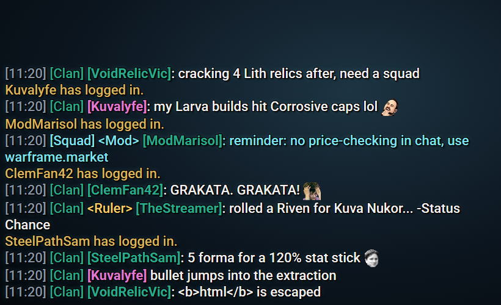

# Twitch Chat - Warframe Clan Chat Overlay

A single-file OBS Browser Source that shows your live Twitch chat styled like Warframe's in-game clan chat. Sister project of the WoW Guild Chat and Phasmophobia Radio overlays: same engine, no install, no libraries, no Twitch login.

## The theme

- **Clan chat lines:** `[HH:MM] [Clan] [Name]: message` with the `[Clan]` tag and names in the game's clan green (`#2AAA8C`) and message text in chat white (`#EFEFEF`), with in-game style timestamps (`timestamps: false` hides them). Moderators talk in `[Squad] <Mod>` in Tenno energy cyan.
- **Broadcaster:** `<Ruler>` tag (the top clan rank) in gold.
- **Name colors:** everyone is clan green by default, like in-game. Chatters can pick one of 15 damage-type colors (Impact, Puncture, Slash, Heat, Cold, Electricity, Toxin, Blast, Corrosive, Gas, Magnetic, Radiation, Viral, Void, Tau) with `!color Viral`, `!color electric` (also `elec`, `fire`, `ice`, `poison`, `rad`, `mag`, `sentient`), `!color #ff8800`, or `!color reset`. `!colors` shows every option on the overlay, each in its own color (30 s cooldown; the overlay is read-only, so it can't reply in Twitch chat). Set `colors.name: ""` to give every chatter an automatic damage-type color instead.
- **System lines** in Orokin gold: `Name has logged in.` on first message, `Name has joined the clan.` on a sub/gift sub.
- **Holographic slide:** lines slide in with a brief energy flash, like the Orbiter's menus, and slide out when they fade.
- **Font:** Roboto (Google Fonts), the face Warframe uses for chat and body text. Falls back to Segoe UI/Arial if offline.

Everything else matches the other overlays: anonymous connection with reconnect, emotes, `/me`, mod deletions/timeouts/bans remove lines, ignored bots, HTML-safe text.

## Setup

1. Put `warframechat.html` and `config.example.js` in a folder, copy `config.example.js` to `config.js` and set `channel`.
2. In OBS add a **Browser** source, tick **Local file**, choose `warframechat.html`, size `800` x `450`, clear **Custom CSS**.
3. Preview without live chat: untick Local file and use `file:///C:/path/to/warframechat.html?test=1`. `?channel=name` overrides the channel.

## Configuration

Edit `config.js`; see the comments in `config.example.js`. `colors`, `colors.damage` and `colorAliases` merge, so you can override a single entry. `ignoredUsers` replaces the whole list. After editing, refresh the Browser Source in OBS.

## More Twitch chat overlays

Same engine, different games:

- [World of Warcraft Guild Chat](https://github.com/Supaju/TwitchChatToWoWGuildChat): `[Guild] [Name]: message` in guild green with WoW class colors.
- [Phasmophobia Radio](https://github.com/Supaju/TwitchChatPhasmoOverlay): walkie-talkie chatter in a CRT terminal font with ghost-type colors.
